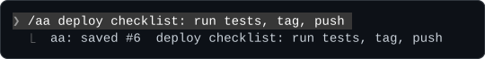
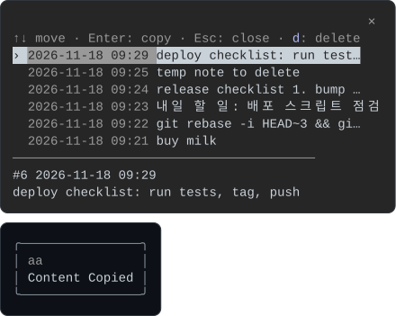
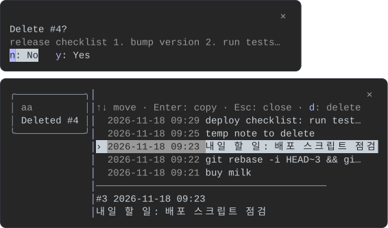
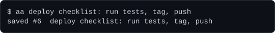
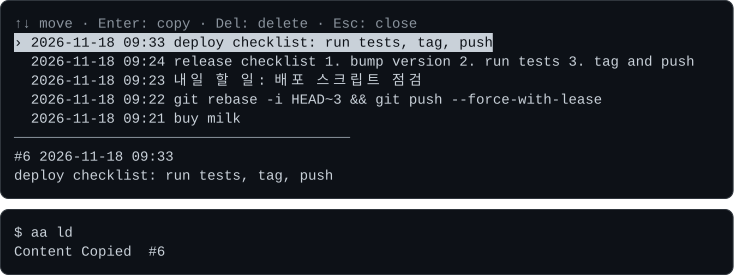
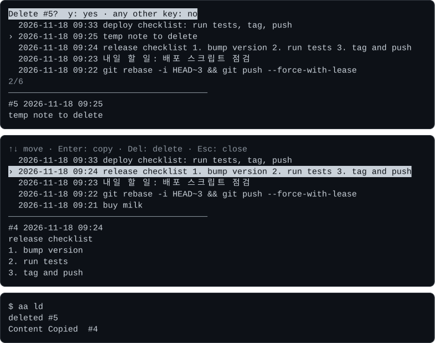

# aa — Add Anything

[English](README.md) · **한국어**

AI 코딩 CLI 안에서 쓰는 메모장입니다. `/aa` 뒤에 적으면 어느 세션에서든 바로 저장되고, 다른 앱을 열 필요가 없습니다. 나중에 목록에서 고르면 클립보드에 복사되므로 원하는 곳에 붙여 넣으면 됩니다.

**Claude Code**, **Codex CLI**, **Kiro CLI**, 그리고 일반 **터미널 명령**으로 동작합니다. 모두 같은 메모 파일을 쓰기 때문에 한 곳에서 저장한 메모가 다른 곳에서도 보입니다.

## 사용법

할 일은 **저장**, **로드**, **삭제** 세 가지뿐입니다. 예시는 Claude Code 기준이며, [다른 CLI](#cli별-같은-세-가지)에서도 같은 방식입니다.

### 1. 저장 — `/aa <메모>`

```
/aa deploy checklist: run tests, tag, push
```



`/aa` 뒤에 적은 내용 전체가 메모가 됩니다. 문장, 명령어, 숫자 모두 됩니다 (`/aa 3`은 "3"을 저장합니다). 일반 셸에서는 셸이 그 줄을 먼저 해석하므로, `$`, `*`, `#`, 따옴표가 든 내용은 따옴표로 감싸거나 파이프로 넘기세요: `echo '내용' | aa -` (Windows PowerShell 5.1에서는 먼저 `$OutputEncoding = [Text.UTF8Encoding]::new($false)`를 실행해야 한글이 파이프에서 깨지지 않습니다).

### 2. 로드 — `/aa ld`

```
/aa ld            전체 메모, 최신순
/aa ld deploy     "deploy"가 들어간 메모만
```



| 키 | 동작 |
| --- | --- |
| `↑` `↓` | 이동. 커서가 놓인 메모의 전체 내용이 목록 아래에 보입니다. |
| `Enter` | 그 메모를 Ctrl+C처럼 클립보드에 복사하고, **Content Copied** 안내가 잠깐 뜬 뒤 목록이 닫힙니다. |
| `Esc` | 목록을 닫습니다. 복사되지 않습니다. |

복사한 뒤에는 프롬프트, 에디터, 다른 창 등 필요한 곳에 Ctrl+V로 붙여 넣으면 됩니다.

### 3. 삭제 — 목록에서 `d`

목록을 열고(`/aa ld`) 지울 메모로 이동한 뒤 `d`를 누릅니다. 먼저 확인을 묻고, `y`면 삭제, `n`(또는 Enter)이면 그대로 둡니다.



목록을 띄울 수 없는 곳(스크립트, 에이전트)에서는 `/aa rm <번호>`로 해당 번호의 메모를 지웁니다.

### CLI별 같은 세 가지

| | Claude Code | Codex CLI | Kiro CLI | 터미널 |
| --- | --- | --- | --- | --- |
| 저장 | `/aa <메모>` | `$aa <메모>` | `/aa <메모>` | `aa <메모>` |
| 로드 | `/aa ld [키워드]` | `$aa ld [키워드]` | `/aa ld [키워드]` | `aa ld [키워드]` |
| 삭제 | 목록에서 `d` | `$aa rm <번호>` | `/aa rm <번호>` | 목록에서 `Del` (또는 `d`) |
| 실행 주체 | Claude Code 자체. 모델 호출 없음 | 모델이 skill로 실행 | 모델이 skill로 실행 | 셸. 모델 없음 |

Claude Code와 터미널에서는 목록을 키보드로 직접 다룹니다. Codex와 Kiro에서는 모델이 명령을 대신 실행하고 결과를 출력하므로, `ld`는 목록을 텍스트로 보여 주고(키워드에 딱 하나만 걸리면 그 메모 전체를 출력하고, 샌드박스가 허용하면 복사까지 합니다) 삭제는 번호로 합니다.

일반 셸에서 쓰는 터미널 명령:







그림은 실제 실행 화면을 기록해 필요한 부분만 잘라 낸 것입니다.

## 설치

### Claude Code

Claude Code 세션의 프롬프트에서:

```
/plugin install aa --marketplace jesus4000/aa-memo
```

marketplace 추가를 묻는 질문에 `y`로 답하고, scope는 **user**를 고르면 모든 세션과 프로젝트에서 `/aa`를 쓸 수 있습니다. 제거는 `claude plugin uninstall aa`.

로컬 사본으로 설치하려면:

```
git clone https://github.com/jesus4000/aa-memo
claude plugin install aa --marketplace ./aa-memo
```

이 경우 Claude Code가 그 폴더를 직접 읽으므로 폴더를 옮기지 마세요. 업데이트를 pull한 뒤에는 `/reload-plugins`를 실행합니다.

### Codex CLI

```
codex plugin marketplace add jesus4000/aa-memo
codex plugin add aa@aa-memo
```

그다음 Codex에서 `$aa <메모>`를 입력합니다.

Codex는 프로젝트 폴더 안에서만 쓸 수 있는 샌드박스에서 명령을 실행하는데, 메모 파일은 홈 폴더에 있습니다. 폴더를 한 번 만들고, `~/.codex/config.toml`에서 샌드박스가 그 폴더에 쓸 수 있게 해 주세요:

```
mkdir ~/.aa
```

```toml
[sandbox_workspace_write]
writable_roots = ["/home/you/.aa"]    # Windows: "C:\\Users\\you\\.aa"
```

이 설정이 없으면 저장할 때 `aa: cannot write ... in a sandboxed agent, allow writes to ...` 오류로 끝납니다.

### Kiro CLI

Kiro는 `~/.kiro/skills`에서 skill을 읽습니다. skill 폴더를 그곳에 복사합니다:

```
git clone https://github.com/jesus4000/aa-memo
mkdir -p ~/.kiro/skills
cp -r aa-memo/plugins/aa/skills/aa ~/.kiro/skills/aa
```

Windows PowerShell에서는: `Copy-Item -Recurse aa-memo\plugins\aa\skills\aa $HOME\.kiro\skills\aa`.

그다음 Kiro에서 `/aa <메모>`를 입력합니다.

### 터미널 명령

Node.js 18 이상만 있으면 됩니다. 다른 의존성은 없습니다.

```
npm i -g github:jesus4000/aa-memo
```

`aa` 명령이 생깁니다 (`aa`라는 이름이 이미 쓰이고 있을 때를 위해 같은 명령인 `aa-memo`도 함께 생깁니다). Codex나 Kiro로 작업하면서 키보드 목록을 쓰고 싶을 때도 이 방법을 씁니다: 옆 터미널에서 `aa ld`를 실행하세요.

복사는 시스템 클립보드를 씁니다: Windows와 WSL은 PowerShell, macOS는 `pbcopy`, Linux는 `wl-copy`, `xclip`, `xsel` 중 있는 것. 아무것도 없으면 터미널 자체의 클립보드 시퀀스(OSC 52)로 보내는데, 터미널은 받았는지 알려 주지 않으므로 이때는 `Copy sent to the terminal`이라고 표시됩니다.

## 테스트된 범위

| | 테스트 여부 |
| --- | --- |
| Claude Code | 됨: mod 테스트, 그리고 Windows의 실제 세션에서 직접 확인 (저장, 목록, 복사, 삭제, 취소). |
| 터미널 명령 | 됨: 자체 테스트, 그리고 Windows의 실제 콘솔에서 직접 확인. macOS와 Linux의 클립보드 경로는 작성만 되어 있고 작성자가 실행해 보지는 않았습니다. |
| Codex CLI | 일부: Windows에서 플러그인 설치와 `codex exec`를 통한 저장을 위 샌드박스 설정과 함께 확인. 대화형 화면에서는 아직 써 보지 않았습니다. |
| Kiro CLI | 안 됨. skill은 Kiro가 읽는 Agent Skills 형식을 따르지만, 작성자가 Kiro에서 실행해 보지는 않았습니다. 제보 환영합니다. |

## 메모가 저장되는 곳

`~/.aa/memos.jsonl` (Windows는 `%USERPROFILE%\.aa\memos.jsonl`)에 한 줄에 JSON 하나씩 저장되며, 모든 CLI, 세션, 프로젝트가 함께 씁니다. 일반 텍스트 파일이므로 백업, 동기화, grep 모두 자유롭게 할 수 있습니다.

메모는 암호화되지 않습니다. 비밀번호나 키는 저장하지 마세요.

- **Claude Code**: 저장과 로드는 모델을 호출하지 않습니다. 다만 입력한 `/aa ...` 줄은 다른 명령처럼 대화에 남기 때문에 같은 세션에서 다음 메시지를 보낼 때 모델이 읽을 수 있고, Claude Code의 로컬 기록에도 남을 수 있습니다.
- **Codex와 Kiro**: 모델이 명령을 실행하므로 저장하는 메모와 출력되는 목록을 모델이 읽고, 쓸 때마다 한 턴이 소모됩니다.
- **터미널 명령**: 모델이 전혀 관여하지 않습니다.

## 제한 사항

- 명령은 `ld`와 `rm <번호>` 두 가지뿐이고 나머지는 모두 메모입니다. 그래서 정확히 `ld ...`나 `rm 3` 형태인 메모는 저장할 수 없습니다.
- Claude Code에서 삭제 키는 문자 `d`입니다. mod는 문자와 숫자만 단축키로 쓸 수 있고 Delete 키는 쓸 수 없습니다. 터미널 목록에서는 `Del`과 `d` 모두 됩니다 (Mac 키보드의 `Del`은 `fn`+`delete`).
- 메모 파일에는 잠금이 없습니다. 두 도구가 같은 몇 밀리초 안에 쓰면 메모가 유실되거나 두 메모가 같은 번호를 받을 수 있습니다.
- 파일 안에서 메모가 아닌 줄(직접 편집했거나 손상된 줄)은 목록에 보이지 않으며, 파일에는 그대로 남습니다.
- 삭제한 메모의 번호는 나중 메모에 다시 쓰일 수 있습니다.
- Claude Code mod는 early-access 플러그인 API를 쓰며, 릴리스마다 바뀔 수 있습니다.

## 개발

```
claude plugin validate .      # mod의 manifest와 hooks
claude plugin test .          # tests/aa.test.ts
npm test                      # tests/cli.mjs, 터미널 명령
```

## License

MIT
