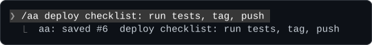
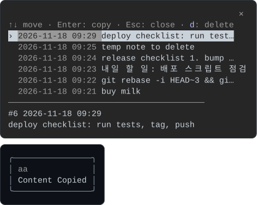
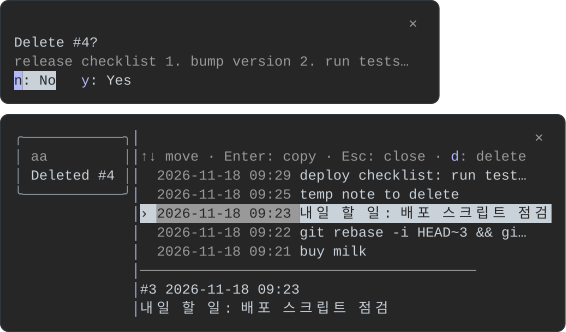
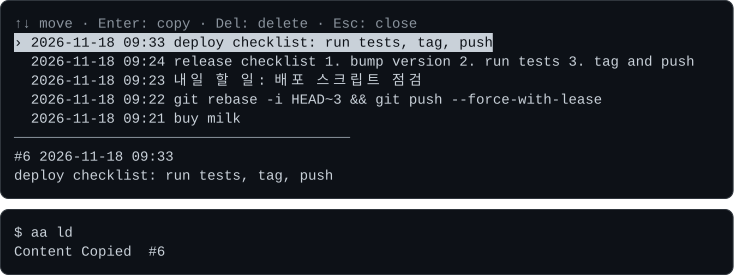

# aa — Add Anything

**English** · [한국어](README.ko.md)

A memo pad inside Claude Code. Type `/aa` and a note is saved at once, from any session, without opening another app. Later, pick it from a list and it lands on your clipboard, ready to paste wherever you want it.

Works in **Claude Code** and as a plain **terminal command**. Both share one memo file, so a memo saved in one shows up in the other.

## Usage

There are three things to do: **save**, **load**, **delete**. The examples are from Claude Code; the [terminal command](#in-the-terminal) works the same way.

### 1. Save — `/aa <memo>`

```
/aa deploy checklist: run tests, tag, push
```



Everything after `/aa` is the memo: a sentence, a command, a number (`/aa 3` saves "3"). In a plain shell the shell reads the line first, so quote text that has `$`, `*`, `#` or quotes in it, or pipe it in: `echo 'the text' | aa -` (in Windows PowerShell 5.1, run `$OutputEncoding = [Text.UTF8Encoding]::new($false)` first, or text outside ASCII is lost in the pipe).

### 2. Load — `/aa ld`

```
/aa ld            every memo, newest first
/aa ld deploy     only the memos containing "deploy"
```



| Key | What it does |
| --- | --- |
| `↑` `↓` | Move. The memo under the cursor is shown whole below the list. |
| `Enter` | Copies that memo to the clipboard, like Ctrl+C, says **Content Copied** and closes the list. |
| `Esc` | Closes the list. Nothing is copied. |

Paste it with Ctrl+V wherever you need it: the prompt, an editor, another window.

### 3. Delete — `d` in the list

Open the list (`/aa ld`), move to the memo and press `d`. It asks first; `y` deletes, `n` (or Enter) keeps the memo.



To delete without opening the list, `/aa rm <id>` deletes the memo with that number.

### In the terminal

| | Claude Code | Terminal |
| --- | --- | --- |
| Save | `/aa <memo>` | `aa <memo>` |
| Load | `/aa ld [keyword]` | `aa ld [keyword]` |
| Delete | `d` in the list | `Del` (or `d`) in the list |

In both, the list is yours to drive with the keyboard, and nothing calls a model.





The pictures are real screens, recorded from a running session and cropped.

## Install

### Claude Code

At the prompt of a Claude Code session:

```
/plugin install aa --marketplace jesus4000/aa-memo
```

Answer `y` to add the marketplace, then pick the **user** scope so `/aa` works in every session and project. Uninstall with `claude plugin uninstall aa`.

From a local copy instead:

```
git clone https://github.com/jesus4000/aa-memo
claude plugin install aa --marketplace ./aa-memo
```

Claude Code then reads the mod straight from that folder, so keep the folder where it is; after pulling an update run `/reload-plugins`.

### Terminal command

Needs Node.js 18 or later; nothing else is installed.

```
npm i -g github:jesus4000/aa-memo
```

This adds the command `aa` (and `aa-memo`, the same thing, in case `aa` is already taken on your machine).

Copying uses the system clipboard: PowerShell on Windows and WSL, `pbcopy` on macOS, `wl-copy`, `xclip` or `xsel` on Linux. When none of them is there, the memo is sent to the terminal's own clipboard sequence (OSC 52); a terminal never says whether it took it, so the line then reads `Copy sent to the terminal`.

## Update

Already installed? An update never touches your memos in `~/.aa/memos.jsonl`.

| Installed as | Update with |
| --- | --- |
| Claude Code plugin | `claude plugin marketplace update aa-memo`, then `claude plugin update aa@aa-memo`, then restart Claude Code |
| Claude Code, from a local copy | `git pull` in that folder, then `/reload-plugins` |
| Terminal command | `npm i -g github:jesus4000/aa-memo` again |

Codex CLI and Kiro CLI are no longer supported: there the model runs the command and can only print the list as text, not the keyboard list. To remove the Codex plugin: `codex plugin remove aa@aa-memo`, then `codex plugin marketplace remove aa-memo`. To remove the Kiro skill: `rm -rf ~/.kiro/skills/aa` (PowerShell: `Remove-Item -Recurse $HOME\.kiro\skills\aa`).

Coming from 0.1: `/aa load` is now `/aa ld`, and `/aa 3` saves the memo "3" instead of loading memo 3. Pick a memo from the `/aa ld` list instead; your saved memos are read as before.

## What has been tested

| | Tested |
| --- | --- |
| Claude Code | Yes: the mod's tests, and by hand in a real session on Windows (save, list, copy, delete, cancel). |
| Terminal command | Yes: its tests, and by hand in a real console on Windows. macOS and Linux clipboard paths are written but not run by the author. |

## Where memos live

One JSON object per line in `~/.aa/memos.jsonl` (`%USERPROFILE%\.aa\memos.jsonl` on Windows), shared by Claude Code and the terminal command, in every session and project. It is a plain text file: back it up, sync it or grep it as you like.

Memos are stored unencrypted. Do not use aa for passwords or keys.

- **Claude Code**: saving and loading never call the model. The `/aa ...` line you typed stays in the conversation like any other command, so the model can read it on your next message in that session, and it can remain in Claude Code's local history.
- **Terminal command**: no model is involved at all.

## Limits

- `ld` and `rm <id>` are the two commands; everything else is a memo. So a memo cannot be exactly `ld ...` or `rm 3`.
- In Claude Code the delete key is the letter `d`: a mod can bind letters and digits, not the Delete key. In the terminal list both `Del` and `d` work (on a Mac keyboard `Del` is `fn`+`delete`).
- There is no lock on the memo file. Two tools writing within the same few milliseconds can lose memos or give two memos the same number.
- A line in the file that is not a memo (edited by hand, damaged) is not shown; it is left in the file as it is.
- A deleted memo's number can be given to a later memo.
- The Claude Code mod uses the early-access plugin API, which may change between releases.

## Develop

```
claude plugin validate .      # the mod's manifest and hooks
claude plugin test .          # tests/aa.test.ts
npm test                      # tests/cli.mjs, the terminal command
```

## License

MIT
