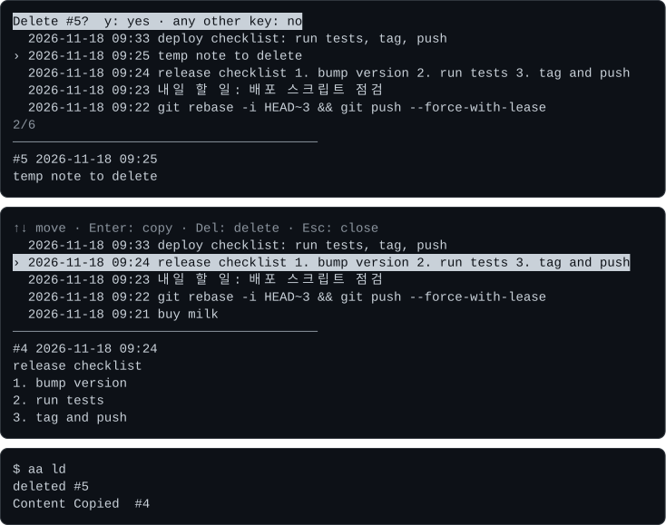

# aa — Add Anything

**English** · [한국어](README.ko.md)

A memo pad inside your AI coding CLI. Type `/aa` and a note is saved at once, from any session, without opening another app. Later, pick it from a list and it lands on your clipboard, ready to paste wherever you want it.

Works in **Claude Code**, **Codex CLI**, **Kiro CLI** and as a plain **terminal command**. They all share one memo file, so a memo saved in one shows up in the others.

## Usage

There are three things to do: **save**, **load**, **delete**. The examples are from Claude Code; the [other CLIs](#the-same-three-in-every-cli) spell them the same way.

### 1. Save — `/aa <memo>`

```
/aa deploy checklist: run tests, tag, push
```


Everything after `/aa` is the memo: a sentence, a command, a number (`/aa 3` saves "3"). In a plain shell the shell reads the line first, so quote text that has `$`, `*`, `#` or quotes in it, or pipe it in: `echo 'the text' | aa -` (in Windows PowerShell 5.1, run `$OutputEncoding = [Text.UTF8Encoding]::new($false)` first, or text outside ASCII is lost in the pipe).

### 2. Load — `/aa ld`

```
/aa ld            every memo, newest first
/aa ld deploy     only the memos containing "deploy"
```


| Key | What it does |
| --- | --- |
| `↑` `↓` | Move. The memo under the cursor is shown whole below the list. |
| `Enter` | Copies that memo to the clipboard, like Ctrl+C, says **Content Copied** and closes the list. |
| `Esc` | Closes the list. Nothing is copied. |

Paste it with Ctrl+V wherever you need it: the prompt, an editor, another window.

### 3. Delete — `d` in the list

Open the list (`/aa ld`), move to the memo and press `d`. It asks first; `y` deletes, `n` (or Enter) keeps the memo.


Where no list can be shown (a script, an agent), `/aa rm <id>` deletes the memo with that number.

### The same three in every CLI

| | Claude Code | Codex CLI | Kiro CLI | Terminal |
| --- | --- | --- | --- | --- |
| Save | `/aa <memo>` | `$aa <memo>` | `/aa <memo>` | `aa <memo>` |
| Load | `/aa ld [keyword]` | `$aa ld [keyword]` | `/aa ld [keyword]` | `aa ld [keyword]` |
| Delete | `d` in the list | `$aa rm <id>` | `/aa rm <id>` | `Del` (or `d`) in the list |
| Who runs it | Claude Code itself; no model call | the model, as a skill | the model, as a skill | your shell; no model |

In Claude Code and in the terminal the list is yours to drive with the keyboard. In Codex and Kiro the model runs the command for you and prints the result, so `ld` prints the list as text (a keyword that matches exactly one memo prints it whole and, where the sandbox allows it, copies it), and deleting is by number.

The terminal command, here in a plain shell:




The pictures are real screens, recorded from a running session and cropped.

## Install

### Claude Code

At the prompt of a Claude Code session:

```
/plugin install aa --marketplace jesus4000/aa-memo
```

Answer `y` to add the marketplace, then pick the **user** scope so `/aa` works in every session and project. Uninstall with `claude plugin uninstall aa`.

From a local copy instead:

```
git clone https://github.com/jesus4000/aa-memo
claude plugin install aa --marketplace ./aa-memo
```

Claude Code then reads the mod straight from that folder, so keep the folder where it is; after pulling an update run `/reload-plugins`.

### Codex CLI

```
codex plugin marketplace add jesus4000/aa-memo
codex plugin add aa@aa-memo
```

Then type `$aa <memo>` in Codex.

Codex runs commands in a sandbox that may only write inside the project folder, and the memo file is in your home folder. Create the folder once and let the sandbox write to it, in `~/.codex/config.toml`:

```
mkdir ~/.aa
```

```toml
[sandbox_workspace_write]
writable_roots = ["/home/you/.aa"]    # Windows: "C:\\Users\\you\\.aa"
```

Without this, saving ends with `aa: cannot write ... in a sandboxed agent, allow writes to ...`.

### Kiro CLI

Kiro reads skills from `~/.kiro/skills`. Copy the skill folder there:

```
git clone https://github.com/jesus4000/aa-memo
mkdir -p ~/.kiro/skills
cp -r aa-memo/plugins/aa/skills/aa ~/.kiro/skills/aa
```

On Windows PowerShell: `Copy-Item -Recurse aa-memo\plugins\aa\skills\aa $HOME\.kiro\skills\aa`.

Then type `/aa <memo>` in Kiro.

### Terminal command

Needs Node.js 18 or later; nothing else is installed.

```
npm i -g github:jesus4000/aa-memo
```

This adds the command `aa` (and `aa-memo`, the same thing, in case `aa` is already taken on your machine). It is also the way to get the keyboard list while working in Codex or Kiro: run `aa ld` in a terminal next to it.

Copying uses the system clipboard: PowerShell on Windows and WSL, `pbcopy` on macOS, `wl-copy`, `xclip` or `xsel` on Linux. When none of them is there, the memo is sent to the terminal's own clipboard sequence (OSC 52); a terminal never says whether it took it, so the line then reads `Copy sent to the terminal`.

## What has been tested

| | Tested |
| --- | --- |
| Claude Code | Yes: the mod's tests, and by hand in a real session on Windows (save, list, copy, delete, cancel). |
| Terminal command | Yes: its tests, and by hand in a real console on Windows. macOS and Linux clipboard paths are written but not run by the author. |
| Codex CLI | Partly: installing the plugin and saving through `codex exec` on Windows, with the sandbox setting above. The interactive screen has not been tried. |
| Kiro CLI | No. The skill follows the Agent Skills format Kiro reads, but the author has not run it there. Reports are welcome. |

## Where memos live

One JSON object per line in `~/.aa/memos.jsonl` (`%USERPROFILE%\.aa\memos.jsonl` on Windows), shared by every CLI, session and project. It is a plain text file: back it up, sync it or grep it as you like.

Memos are stored unencrypted. Do not use aa for passwords or keys.

- **Claude Code**: saving and loading never call the model. The `/aa ...` line you typed stays in the conversation like any other command, so the model can read it on your next message in that session, and it can remain in Claude Code's local history.
- **Codex and Kiro**: the model runs the command, so it reads the memo you save and the list it prints, and each use costs a turn.
- **Terminal command**: no model is involved at all.

## Limits

- `ld` and `rm <id>` are the two commands; everything else is a memo. So a memo cannot be exactly `ld ...` or `rm 3`.
- In Claude Code the delete key is the letter `d`: a mod can bind letters and digits, not the Delete key. In the terminal list both `Del` and `d` work (on a Mac keyboard `Del` is `fn`+`delete`).
- There is no lock on the memo file. Two tools writing within the same few milliseconds can lose memos or give two memos the same number.
- A line in the file that is not a memo (edited by hand, damaged) is not shown; it is left in the file as it is.
- A deleted memo's number can be given to a later memo.
- The Claude Code mod uses the early-access plugin API, which may change between releases.

## Develop

```
claude plugin validate .      # the mod's manifest and hooks
claude plugin test .          # tests/aa.test.ts
npm test                      # tests/cli.mjs, the terminal command
```

## License

MIT
